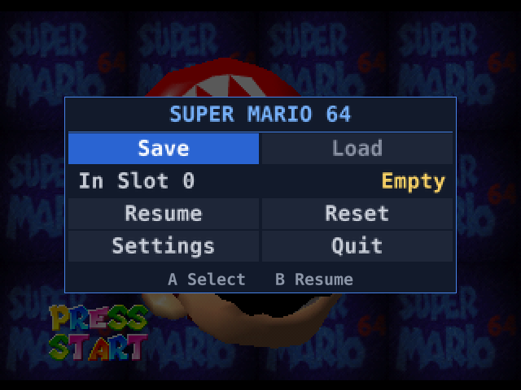
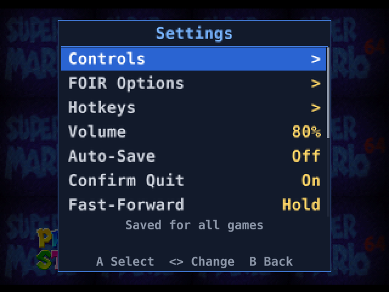
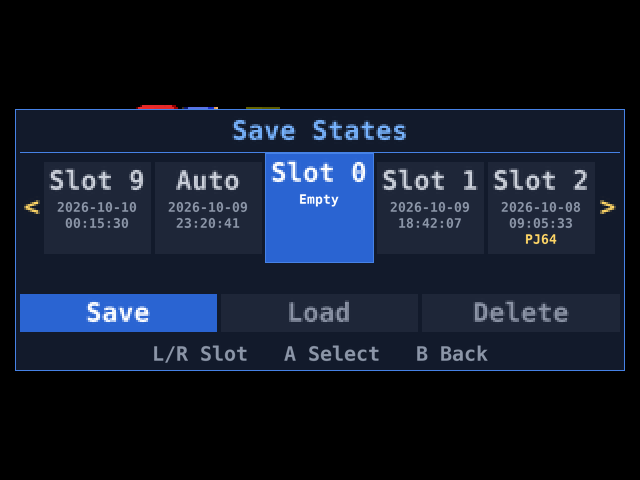
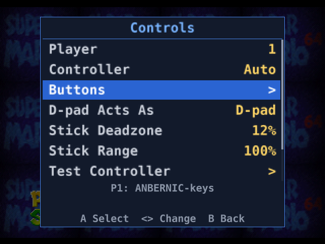

# mupen64plus-input-suxty

A gamepad-only, in-game menu for Mupen64Plus on retro handhelds, built as an ordinary Mupen64Plus **input plugin**
(`mupen64plus-input-suxty.so`). Press a button combo while a game runs and a menu opens over the dimmed last frame:
save states, reset, controller remapping, a few options and quit, with no keyboard, mouse or config file to edit.

suxty is not a launcher, a ROM browser or a front-end. Your front-end and your video, RSP and audio plugins stay yours:
you only name this plugin as the input plugin. It works with the stock `mupen64plus` / `mupen64plus-ui-console` and with the
patched builds that CFWs ship, and needs only SDL2 (the one the front-end already uses) and the core.

## Previews

 
 

## What it gives you

- **Save states.** A slot carousel (Save, Load, Delete) with each slot's last-saved time. Slots that exist only as Project64
  states are shown (tagged "PJ64") and can be loaded. Every save is confirmed with "Saved", or reported if it was not written.
- **Reset and quit.** Soft reset (like the console's button), hard reset (power cycle) and Quit, each with a confirmation.
- **Controller remapping.** Per pad model and per game: any physical control to any N64 input, a D-pad / stick swap
  ("D-pad Acts As"), a **C-Face Shift** hold button (the face buttons act as C buttons), a **Soft Tilt** hold button (half stick),
  stick deadzone and range, a Test Controller page, and per-player pad choice (players 1-4).
- **Hotkeys** (hold Select by default): quick-save, quick-load, next / previous slot, fast-forward (hold or toggle, with a speed
  setting) and quit. All of them are reassignable. While the hotkey button is held the game sees a neutral controller.
- **Volume** slider for the core's audio volume (hidden if the core cannot report it).
- **Opt-in auto-save on quit** to a separate auto slot, with rotated backups and a start-up check that restores the last good
  one if a write was cut short.
- **Per-game profiles.** Every setting has a global value and may have its own value for one game ("Apply To: All Games /
  This Game", "Save Game Profile").
- **FOIR Options**, when the video plugin is `mupen64plus-rdp-foir`: widescreen, smoothing, frame skip and the
  other foir options, live where foir allows it. With any other video plugin this page is not there.

## Using it

Name the plugin as the input plugin, for example:

```sh
mupen64plus --gfx mupen64plus-rdp-foir.so --rsp mupen64plus-rsp-hle.so --audio mupen64plus-audio-sdl.so \
            --input /path/to/mupen64plus-input-suxty.so  game.z64
```

The plugin can live anywhere. Setup for ROCKNIX and spruce is in [docs/launchers.md](docs/launchers.md).

**Select + Start** opens and closes the menu (configurable; Select + Start always works as a recovery combo).

| Button | In the menu |
|---|---|
| D-pad / left stick | Move; Left / Right changes sliders, choices and the slot |
| A | Confirm (on a mapping row: capture a control) |
| B | Back / close |
| X | Clear a mapping or hotkey; in "This Game" scope, reset a row to the global value |
| L / R | Scroll the save-slot carousel |

The main menu is a grid: **Save | Load**, the slot to use, **Resume | Reset**, **Settings | Quit**. **Settings** has Controls, FOIR Options
(with foir), Hotkeys, Volume, Auto-Save, Confirm Quit, Fast-Forward, FF Speed, Dim, Notices, Apply To, and Save Game Profile.

Default hotkeys (hold **Select**):

| Combo | Action |
|---|---|
| R / L | Quick-save / quick-load the current slot |
| Right / Left | Next / previous slot |
| Y | Fast-forward |
| B | Quit (pressed twice within 2 s while "Confirm Quit" is on) |

suxty never loads anything by itself. To continue where you quit with auto-save on, start the game through your front-end with
`--savestate "<savedir>/<state name>.auto.st"` (see [docs/saves.md](docs/saves.md)).

## Status

Pre-alpha. Verified on x86_64 (headless, stock ui-console), on the **RG35XX SP** (spruce's patched mupen64plus, foir and Rice) and on the
**RK3566 / ROCKNIX** handheld (stock mupen64plus 2.5.9, foir and Rice). Known limitations:

- Only the core's Controller Pak is offered (no Rumble Pak, Transfer Pak, keyboard or mouse input for the game).
- Only OpenGL / GLES video plugins work (no Vulkan render mode).
- Menu and hotkey combos are sampled once per presented frame.
- The core's and the other plugins' options are not editable here; use your front-end for those.

More in [docs/saves.md](docs/saves.md) and [docs/development.md](docs/development.md).

## More documentation

- [docs/launchers.md](docs/launchers.md): launch lines and setup for stock ui-console, ROCKNIX and spruce, where files are written.
- [docs/configuration.md](docs/configuration.md): `suxty.cfg` and per-game files, layering, keys and defaults, hotkey and lock-out rules, upgrading.
- [docs/saves.md](docs/saves.md): how saving, loading and auto-save work, the auto-save safety net, FOIR Options storage.
- [docs/development.md](docs/development.md): architecture, tests, debug scripting and screenshot harness, wording rules.

## Building

```sh
make -C projects/unix all     # -> mupen64plus-input-suxty.so (SDL2 headers and the Mupen64Plus core API headers; APIDIR=... if not found)
make -C projects/unix check   # unit tests under ASan / UBSan
tools/build-aarch64.sh <dir with the device's libSDL2-2.0.so.0>   # aarch64 cross build
```

The stock Ubuntu aarch64 cross compiler emits glibc 2.38 symbols. For older devices (such as spruce on the RG35XX SP) use the
glibc 2.31 route of the n64-plugins workspace, `toolchains/rg35xxsp/build.sh suxty`, whose output runs on both handhelds.

## License

**GPLv2 or later**, matching the Mupen64Plus core; full text in `LICENSE`.

The menu font bitmaps in `src/font_data.c` are rasterised from DejaVu Sans Mono Bold (Bitstream Vera licence).
